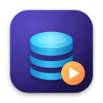
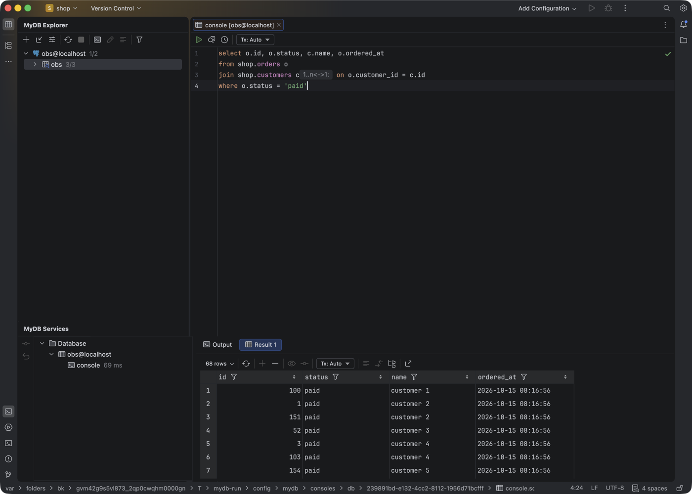
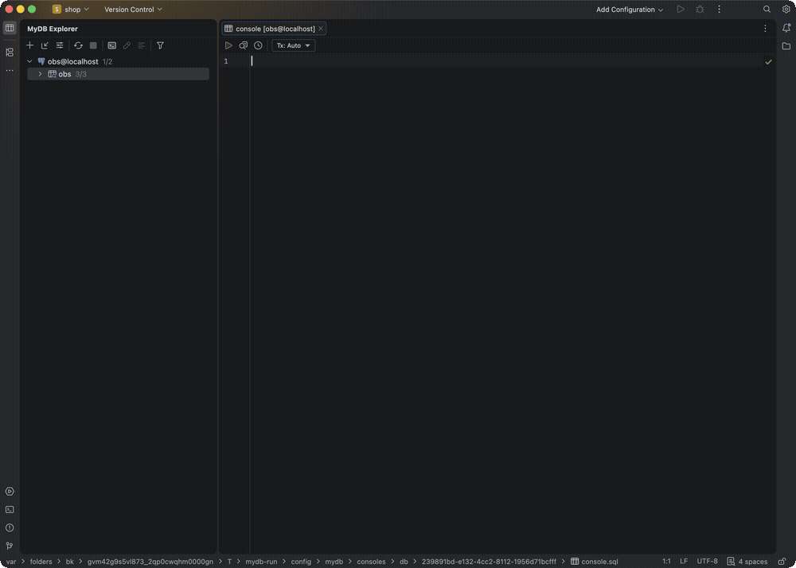
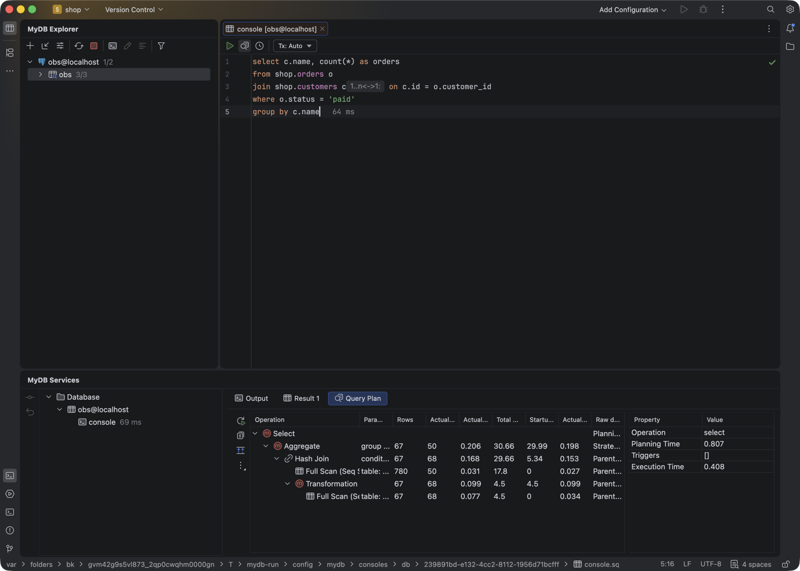

<div align="center">

[English](README.md) · **한국어**



# MyDB IDE

### PostgreSQL, MySQL, MariaDB, SQLite를 위한 무료 오픈 소스 데스크톱 DB IDE

**스키마 탐색, DB를 아는 SQL 편집, 안전한 데이터 편집, 스키마 비교까지. 모두 내 컴퓨터 안에서.**

[](https://github.com/taeyun1215/mydb-ide/releases/latest)
[](https://github.com/taeyun1215/mydb-ide/actions/workflows/ci.yml)
[](https://github.com/taeyun1215/mydb-ide/releases)
[](LICENSE)


[**다운로드**](#다운로드) · [**빠른 시작**](#빠른-시작) · [**기능**](#기능) · [**사용 설명서**](docs/guide.ko.md) · [**자주 묻는 질문**](#자주-묻는-질문) · [**기여하기**](CONTRIBUTING.ko.md)

</div>

> [!IMPORTANT]
> MyDB IDE의 공식 배포처는 이 저장소와 [Releases](https://github.com/taeyun1215/mydb-ide/releases) 페이지뿐입니다. 아직 Apple·Microsoft 서명이 없어서 처음 실행할 때 OS가 확인을 요청합니다. [다운로드](#다운로드)를 참고하세요.

<p align="center"></p>

---

## 목차

- [왜 MyDB IDE인가](#왜-mydb-ide인가)
- [다운로드](#다운로드)
- [빠른 시작](#빠른-시작)
- [기능](#기능)
- [지원 데이터베이스](#지원-데이터베이스)
- [단축키](#단축키)
- [개인정보](#개인정보)
- [자주 묻는 질문](#자주-묻는-질문)
- [소스에서 빌드하기](#소스에서-빌드하기)
- [시험](#시험)
- [구조](#구조)
- [로드맵](#로드맵)
- [기여하기](#기여하기) · [보안](#보안) · [라이선스](#라이선스)

## 왜 MyDB IDE인가

| | |
|---|---|
| 🗂️ **자주 쓰는 DB를 한 도구로** | PostgreSQL, MySQL, MariaDB, SQLite를 같은 탐색기, 같은 콘솔, 같은 결과 그리드로 다룹니다. |
| 🧠 **스키마를 아는 SQL** | 자동완성, 이름 확인, 검사, 빠른 수정이 실제 DB 모델을 바탕으로 동작합니다. 외래 키로 조인 조건도 제안합니다. |
| 🛡️ **기본이 안전** | 그리드에서 고친 값은 제출 전까지 대기하고, 제출하면 한 트랜잭션으로 반영됩니다. `WHERE` 없는 `DELETE`·`UPDATE`는 먼저 묻습니다. 읽기 전용 데이터 소스도 됩니다. |
| 🔒 **개인정보 보호** | 계정, 사용 통계, 업데이트 서버, 플러그인 스토어가 없습니다. 비밀번호는 OS 키체인에 저장됩니다. |
| 🆓 **무료 오픈 소스** | Apache License 2.0, 유료 버전 없음. |

## 다운로드

[Releases 페이지](https://github.com/taeyun1215/mydb-ide/releases/latest)에서 최신 버전을 받으세요.

| OS | Apple Silicon / ARM64 | Intel / x64 |
|---|---|---|
| **macOS** 12+ | [`macos-arm64.dmg`](https://github.com/taeyun1215/mydb-ide/releases/latest/download/MyDB-IDE-2026.2.3-macos-arm64.dmg) | [`macos-x64.dmg`](https://github.com/taeyun1215/mydb-ide/releases/latest/download/MyDB-IDE-2026.2.3-macos-x64.dmg) |
| **Windows** 10+ | [`windows-arm64.exe`](https://github.com/taeyun1215/mydb-ide/releases/latest/download/MyDB-IDE-2026.2.3-windows-arm64.exe) | [`windows-x64.exe`](https://github.com/taeyun1215/mydb-ide/releases/latest/download/MyDB-IDE-2026.2.3-windows-x64.exe) |
| **Linux** | [`linux-arm64.tar.gz`](https://github.com/taeyun1215/mydb-ide/releases/latest/download/MyDB-IDE-2026.2.3-linux-arm64.tar.gz) | [`linux-x64.tar.gz`](https://github.com/taeyun1215/mydb-ide/releases/latest/download/MyDB-IDE-2026.2.3-linux-x64.tar.gz) |

릴리스마다 모든 파일의 SHA-256 체크섬이 `SHA256SUMS.txt`에 있습니다.

<details>
<summary><b>macOS: "MyDB IDE을(를) 열 수 없습니다"</b></summary>

아직 공증 전이라 그렇습니다. DMG를 열어 **MyDB IDE**를 **응용 프로그램**으로 끌어 놓고, 한 번 실행해 본 뒤 **시스템 설정 → 개인정보 보호 및 보안**에서 **그래도 열기**를 누르세요. 터미널에서는:

```sh
xattr -dr com.apple.quarantine "/Applications/MyDB IDE.app"
```
</details>

<details>
<summary><b>Windows: "Windows의 PC 보호"</b></summary>

설치 파일이 아직 코드 서명 전이라 그렇습니다. **추가 정보 → 실행**을 누르세요.
</details>

<details>
<summary><b>Linux</b></summary>

```sh
tar -xzf MyDB-IDE-*-linux-*.tar.gz
./mydb-ide/bin/mydb.sh
```
</details>

## 빠른 시작

1. **데이터 소스 추가**: <kbd>⌘</kbd> <kbd>;</kbd> → **+** → PostgreSQL, MySQL, MariaDB, SQLite 중 선택 → 호스트·DB·사용자·비밀번호 입력 → **Test Connection**.
2. **스키마 고르기**: **Schemas** 탭에서 읽어 올 스키마를 체크합니다.
3. **쿼리**: 새 데이터 소스의 콘솔이 열립니다. 쿼리를 입력하고 <kbd>⌘</kbd> <kbd>↵</kbd>를 누르면 아래에 결과가 나옵니다.
4. **데이터 편집**: 테이블을 고르고 <kbd>⌘</kbd> <kbd>↓</kbd>. 셀을 고치고 행을 추가·삭제한 뒤 <kbd>⌘</kbd> <kbd>↵</kbd>로 제출합니다.
5. **더 해 보기**: <kbd>⌘</kbd> <kbd>N</kbd>은 테이블 만들기, 스키마 두 개를 고르고 <kbd>⌘</kbd> <kbd>D</kbd>는 비교, <kbd>⌥</kbd> <kbd>⇧</kbd> <kbd>⌘</kbd> <kbd>U</kbd>는 ER 다이어그램입니다.

SSH 터널, 트랜잭션, 스키마 비교, 가져오기·내보내기 등은 **[사용 설명서](docs/guide.ko.md)**를 보세요.

다른 IDE 프로젝트에 데이터 소스가 있다면, 탐색기 툴바의 **Import Data Sources from IDE Project…**로 SSH 설정까지 함께 가져올 수 있습니다.

## 기능

<p align="center"><br><sub>JOIN을 입력하면 외래 키로 ON 조건을 제안</sub></p>

<details open>
<summary><b>🗂️ 데이터베이스 탐색기</b></summary>

- 데이터 소스 → 데이터베이스 → 스키마 → 테이블, 뷰, 구체화된 뷰, 루틴, 시퀀스, 컬럼, 키, 인덱스
- 읽어 올 스키마 선택, `표시/전체` 배지
- 바뀐 테이블만 다시 읽는 증분 새로고침, 프로젝트별로 저장되어 재시작 후에도 유지되는 모델
- 빠른 문서(DDL·주석), DDL로 이동, 참조 복사, 필터, 데이터 소스 색(에디터 탭에도 적용)
- 모든 데이터 소스의 테이블·뷰·컬럼을 찾는 Go to Symbol
- DB에 선언되지 않은 관계를 위한 **가상 외래 키**: 자동완성, 조인, 다이어그램에 반영
</details>

<details open>
<summary><b>🧠 SQL 콘솔</b></summary>

- 데이터 소스별 콘솔, 데이터 소스에 연결한 `.sql` 파일
- 스키마·테이블·컬럼·별칭·CTE·키워드 자동완성, **외래 키 기반 조인 조건**을 먼저 제안
- 모르는 테이블·컬럼 강조, 빠른 수정, 검사(`WHERE` 없는 `DELETE`, `GROUP BY`에 없는 컬럼 등)
- 의도 동작: 이름 한정, 조인 좌우 바꾸기, 서브쿼리로 감싸기
- 포매터, 미리보기가 있는 이름 바꾸기(테이블·컬럼·별칭), 사용처 찾기
- 커서 위치 문장, 선택 영역, 스크립트 전체 실행, 결과 집합마다 결과 탭, 쿼리 기록
- 수동/자동 트랜잭션, 격리 수준, 툴바나 Services 창에서 커밋·롤백
- SQL Script 실행 구성
</details>

<details open>
<summary><b>📋 결과 그리드와 테이블 편집기</b></summary>

- 페이지 나눔, 정렬, 값 필터, 컬럼 자동완성이 되는 `WHERE` / `ORDER BY` 필터
- 셀 편집, 행 추가·삭제. **변경은 대기 상태로 남고**, DML로 미리 볼 수 있으며, 한 트랜잭션으로 제출됩니다
- 실패한 행은 서버 오류와 함께 표시되고, 제출 전에는 서버에 아무것도 가지 않습니다
- 값 패널, 행/열 바꾸기, 정확한 행 수, 결과로 차트 그리기
- 두 결과 집합의 데이터 비교
</details>

<details>
<summary><b>🏗️ 스키마 객체</b></summary>

- **테이블**(컬럼, 키, 외래 키, 인덱스, 체크, 생성 컬럼), **뷰**, **구체화된 뷰**, **시퀀스**, **스키마**를 대화 상자에서 만들고 고치기. DDL 미리보기가 실시간으로 바뀝니다
- SQL 생성기, DDL을 콘솔로, 확인을 거치는 TRUNCATE·DROP
</details>

<details>
<summary><b>🔍 비교, 다이어그램, 실행 계획</b></summary>




- 두 스키마나 데이터 소스의 **스키마 비교**: 상태별 객체 트리, DDL 나란히 비교, 속성 비교, 콘솔로 열 수 있는 마이그레이션 스크립트
- 외래 키와 뷰 관계를 그리는 **ER 다이어그램**, PNG·SVG·Mermaid·PlantUML·GraphML 내보내기
- **실행 계획**(`EXPLAIN`, `EXPLAIN ANALYZE`)을 노드 속성이 모두 보이는 트리와 다이어그램으로
</details>

<details>
<summary><b>📦 가져오기와 내보내기</b></summary>

- 결과나 테이블을 CSV, TSV, JSON, SQL `INSERT`, Markdown, HTML, Excel로 내보내기
- CSV/TSV를 새 테이블이나 기존 테이블로 가져오기(형 변환, 오류 파일)
- PostgreSQL은 `pg_dump`, `pg_restore`, `psql`, MySQL은 `mysqldump`, `mysql`
- 스키마를 **DDL 데이터 소스**(`.sql` 파일에서 읽는 모델)로 덤프
- CSV·TSV 파일을 편집 가능한 **Data** 탭으로 열기
</details>

<details>
<summary><b>🔌 연결</b></summary>

- 비밀번호나 키 파일을 쓰는 SSH 터널, 공유 SSH 설정
- `verify-full`까지의 SSL 모드, 사용자 CA, 키 비밀번호가 있는 클라이언트 인증서
- 드라이버 속성, 읽기 전용 데이터 소스, 용도별로 분리된 세션(콘솔·테이블 편집기·메타데이터 읽기가 서로 막지 않음)
- 다른 IDE 프로젝트의 `.idea/dataSources.xml`에서 데이터 소스 가져오기
</details>

## 지원 데이터베이스

| | PostgreSQL | MySQL / MariaDB | SQLite |
|---|:---:|:---:|:---:|
| 탐색기, 메타데이터 읽기 | ✅ | ✅ | ✅ |
| 콘솔, 자동완성, 이름 확인 | ✅ | ✅ | ✅ |
| 그리드 편집 | ✅ | ✅ | ✅ |
| 테이블 만들기·고치기 | ✅ | ✅ | ✅ |
| 뷰 | ✅ | ✅ | ✅ |
| 구체화된 뷰, 시퀀스 | ✅ | – | – |
| 실행 계획 | 트리 + 다이어그램 | 표 | `EXPLAIN QUERY PLAN` |
| 스키마 비교 | ✅ | 예정 | 예정 |
| 덤프·복원 도구 | `pg_dump`, `pg_restore`, `psql` | `mysqldump`, `mysql` | – |
| SSH / SSL | ✅ | ✅ | – |

PostgreSQL 17, MySQL 8.4, MariaDB 11.4, SQLite 3.50에서 시험했습니다. MySQL은 `jdbc:mysql:` URL도 받는 MariaDB Connector/J로 연결합니다.

## 단축키

| 동작 | macOS | Windows / Linux |
|---|---|---|
| 데이터 소스 | <kbd>⌘</kbd> <kbd>;</kbd> | <kbd>Ctrl</kbd> <kbd>Alt</kbd> <kbd>Shift</kbd> <kbd>S</kbd> |
| 새 쿼리 콘솔 | <kbd>⇧</kbd> <kbd>⌘</kbd> <kbd>L</kbd> | 탐색기 툴바 |
| 실행 / 그리드 변경 제출 | <kbd>⌘</kbd> <kbd>↵</kbd> | <kbd>Ctrl</kbd> <kbd>Enter</kbd> |
| 테이블 데이터 편집 | <kbd>⌘</kbd> <kbd>↓</kbd> | <kbd>F4</kbd> |
| DDL로 이동 | <kbd>⌘</kbd> <kbd>B</kbd> | <kbd>Ctrl</kbd> <kbd>B</kbd> |
| 새 객체 | <kbd>⌘</kbd> <kbd>N</kbd> | <kbd>Ctrl</kbd> <kbd>N</kbd> |
| 테이블 수정 | <kbd>⌘</kbd> <kbd>F6</kbd> | <kbd>Ctrl</kbd> <kbd>F6</kbd> |
| 구조 비교 | <kbd>⌘</kbd> <kbd>D</kbd> | <kbd>Ctrl</kbd> <kbd>D</kbd> |
| SQL 생성기 | <kbd>⌥</kbd> <kbd>⌘</kbd> <kbd>G</kbd> | <kbd>Ctrl</kbd> <kbd>Alt</kbd> <kbd>G</kbd> |
| 다이어그램 | <kbd>⌥</kbd> <kbd>⇧</kbd> <kbd>⌘</kbd> <kbd>U</kbd> | <kbd>Ctrl</kbd> <kbd>Alt</kbd> <kbd>Shift</kbd> <kbd>U</kbd> |
| 빠른 문서 | <kbd>F1</kbd> | <kbd>Ctrl</kbd> <kbd>Q</kbd> |
| 사용처 찾기 | <kbd>⌥</kbd> <kbd>F7</kbd> | <kbd>Alt</kbd> <kbd>F7</kbd> |

## 개인정보

MyDB IDE는 외부로 아무것도 보내지 않습니다.

- 사용 통계, 충돌 보고, 오류 전송이 없고 로그는 내 컴퓨터에만 남습니다
- 업데이트 확인, 플러그인 스토어, 온라인 도움말, 계정 동기화가 없습니다
- 비밀번호와 키 비밀번호는 OS 자격 증명 저장소(macOS 키체인)에 저장되고 프로젝트 파일에는 들어가지 않습니다
- `.idea/mydbDataSources.xml`에는 비밀번호 없이 연결 설정만 있어 팀과 공유할 수 있습니다

## 자주 묻는 질문

<details>
<summary><b>정말 무료인가요?</b></summary>

네. Apache 2.0 라이선스이고 유료 버전, 계정, 체험 기간이 없습니다.
</details>

<details>
<summary><b>무엇을 바탕으로 만들었나요?</b></summary>

오픈 소스인 IntelliJ Platform Community Edition(Apache 2.0) 위에 만들었습니다. 에디터, 결과 그리드, 창 시스템은 플랫폼이 제공하고, DB 기능(연결, 메타데이터 읽기, SQL 언어, 편집, 비교, 가져오기·내보내기)은 이 프로젝트가 직접 작성한 코드입니다. [NOTICE](NOTICE)를 참고하세요.
</details>

<details>
<summary><b>비밀번호는 어디에 저장되나요?</b></summary>

OS 자격 증명 저장소에 저장됩니다. macOS는 키체인, Windows는 자격 증명 관리자, Linux는 Secret Service나 KeePass입니다. 프로젝트 파일에는 비밀번호가 들어가지 않습니다.
</details>

<details>
<summary><b>회사에서 써도 되나요?</b></summary>

네. Apache 2.0 라이선스는 상업적 사용을 허용합니다. 운영 DB에 붙을 때는 읽기 전용 데이터 소스와, `WHERE` 없는 `DELETE`·`UPDATE` 확인 기능이 도움이 됩니다.
</details>

<details>
<summary><b>SQL Server, Oracle, ClickHouse도 지원하나요?</b></summary>

[로드맵](#로드맵)에 있습니다. [기능 제안](https://github.com/taeyun1215/mydb-ide/issues/new?template=feature_request.yml)을 올리거나 기존 제안에 공감을 눌러 순서를 정하는 데 힘을 보태 주세요.
</details>

<details>
<summary><b>열 때 macOS나 Windows가 경고하는 이유는?</b></summary>

아직 코드 서명 전이기 때문입니다. 여는 방법은 [다운로드](#다운로드)를 보세요. 서명은 로드맵에 있습니다.
</details>

## 소스에서 빌드하기

필요한 것: macOS, Linux 또는 Windows, JDK 21+, Git, 시험용 Docker, 전체 빌드용 디스크 여유 공간 약 30 GB.

```sh
git clone https://github.com/taeyun1215/mydb-ide.git
cd mydb-ide

# 이 릴리스가 바탕으로 하는 버전의 IDE 플랫폼 소스
git clone --branch idea/262.10968.63 --depth 1 https://github.com/JetBrains/intellij-community.git

# src/product 연결, src/product/patches 적용, 빌드 파일 생성
src/product/setup-community.sh

# 모든 OS·아키텍처용 설치 파일 빌드
cd intellij-community
./build/run_build_target.sh "$(pwd)" //mydb/build:i_build_target
```

첫 빌드는 도구를 내려받느라 20~40분, 그다음부터는 10분 안팎 걸립니다. 설치 파일은 `intellij-community/out/mydb/artifacts/`에 생깁니다.

평소 설정을 건드리지 않고 빌드를 시험하려면:

```sh
tools/mydb-run.sh extract   # 최신 DMG에서 앱 꺼내기
tools/mydb-run.sh start     # 별도 설정·캐시·로그로 실행
tools/mydb-run.sh stop
```

## 시험

시험은 Testcontainers가 Docker로 띄우는 실제 서버(PostgreSQL 17, MySQL 8.4, MariaDB 11.4, sshd)를 대상으로 돌아갑니다.

```sh
src/scripts-test.sh                               # DB 계층: 116개
src/plugin-test.sh                                # IDE 기능: 154개
src/plugin-test.sh 'dev.teo.mydb.plugin.sql.*'    # 일부만
```

`testdb/seed`에는 시드 스키마(`shop`, `shop2`), `testdb/expected`에는 기대 결과가 있습니다. [CI](.github/workflows/ci.yml)가 모든 push와 PR에서 두 시험을 돌립니다.

## 구조

```
src/product/
├── mydb.core/            DB 계층(UI 없음)
│   ├── connection/       JDBC 연결, SSH 터널, SSL, 세션
│   ├── introspect/       PostgreSQL·MySQL·SQLite·DDL 파일 → DbModel
│   ├── exec/             문장 분리, 실행, 페이지, 트랜잭션, 방언
│   ├── edit/             그리드 변경 → DML, 트랜잭션 제출
│   ├── ddl/              방언별 DDL 생성
│   ├── diff/             스키마 비교, 마이그레이션 스크립트
│   ├── plan/             실행 계획
│   └── transfer/         가져오기·내보내기, 덤프 도구, 차트, 데이터 비교
├── mydb.plugin/          IDE 기능
│   ├── explorer/         DB 트리, 동작, 가상 객체
│   ├── sql/              SQL 언어: 렉서, 파서, PSI, 이름 확인, 자동완성, 검사, 포매터
│   ├── console/          콘솔, 실행 대상, 결과, 기록, 실행 구성
│   ├── grid/  table/     결과 그리드, 테이블 편집기
│   ├── objects/          만들기·고치기 대화 상자
│   ├── compare/ diagram/ 스키마 비교 UI, ER·실행 계획 다이어그램
│   └── datasource/       데이터 소스 대화 상자, SSH 설정, 가져오기
├── mydb.resources/       제품 브랜딩, 사용자 정의
├── build/                제품 빌드 정의, 함께 배포하는 라이선스 파일
└── patches/              플랫폼 소스에 대한 수정
```

DB 계층은 Kotlin과 JDBC만 쓰며 따로 시험합니다(`src/core`). IDE 계층은 플랫폼의 에디터, PSI, 그리드, 다이어그램 기반을 씁니다(`src/plugin`).

## 로드맵

- [ ] 서명·공증된 macOS 빌드, 서명된 Windows 설치 파일
- [ ] MySQL·SQLite 스키마 비교
- [ ] SQL Server, Oracle, ClickHouse
- [ ] 한국어 UI
- [ ] CI에서 릴리스 빌드

아이디어가 있으면 [토론](https://github.com/taeyun1215/mydb-ide/discussions)이나 [기능 제안](https://github.com/taeyun1215/mydb-ide/issues/new?template=feature_request.yml)을 열어 주세요.

## 기여하기

기여를 환영합니다. [CONTRIBUTING.ko.md](CONTRIBUTING.ko.md)부터 읽어 주시고, [행동 강령](CODE_OF_CONDUCT.ko.md)을 지켜 주세요.

## 보안

취약점은 [SECURITY.ko.md](SECURITY.ko.md)에 따라 비공개로 제보해 주세요.

## 라이선스

MyDB IDE는 [Apache License 2.0](LICENSE)을 따릅니다.

IntelliJ Platform Community Edition(Apache License 2.0)을 바탕으로 만들었습니다. 서드파티 라이브러리는 [NOTICE](NOTICE)와 각 배포본의 `license/` 폴더에 있습니다. MyDB IDE는 독립 프로젝트이며 JetBrains와 관련이 없고 JetBrains의 보증을 받지 않습니다.
